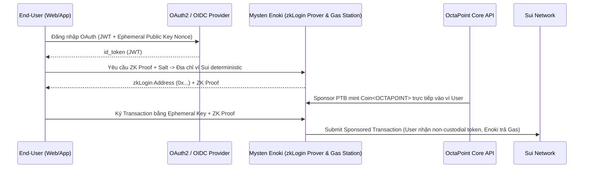
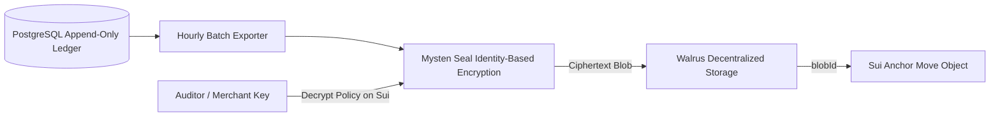

# OctaPoint Future Work & Won't Scope Architecture (`v2.0+` Roadmap)

Tài liệu này mô tả thiết kế kiến trúc, luồng dữ liệu, đánh đổi kỹ thuật và lộ trình nâng cấp từ nền tảng OctaPoint `v1.0` (`Must + Should + Could`) sang các hạng mục thuộc nhóm **Won't** trong phạm vi MVP/Sprint hiện tại.

---

## 1. Non-Custodial Wallet với Sui zkLogin & Enoki Sponsored Gas (`FR-16`)

### Hiện trạng `v1.0`
- Khách hàng cuối chưa cần sở hữu ví Sui riêng (`custodial shared Balance` tại Move package `octapoint_move`).
- Tài khoản ví Backend Signer trả phí gas qua `Gas Quota` của từng Merchant (`FR-27`).

### Thiết kế mục tiêu (`v2.0`)

### Lộ trình chuyển đổi từ `v1.0`
1. Thêm cột `sui_wallet_address` (nullable) vào bảng `customer` và `claim_status` vào `ledger_entries`.
2. Bổ sung Move module `octapoint_coin` phát hành `Coin<OCTAPOINT>` hoặc soulbound `LoyaltyPass` object có `TreasuryCap`.
3. Tạo adapter mới thực thi `ChainClient` (`EnokiSponsoredChainClient`) đặt trong package `com.octapoint.core.chain` để giữ nguyên ranh giới ArchUnit.

---

## 2. Lưu trữ Phi tập trung Walrus & Bảo mật Dữ liệu với Seal (`FR-21`)

### Hiện trạng `v1.0`
- `AnchorService` (`FR-30`) đã đóng gói batch canonical SHA-256 hash, neo digest lên Sui Testnet và tích hợp PoC hook `app.walrus.poc-enabled=true` để đẩy JSON metadata lên `https://publisher.walrus-testnet.walrus.space`.

### Thiết kế mục tiêu (`v2.0`)

- **Lý do dùng Seal + Walrus**: Dữ liệu hóa đơn/khách hàng có thông tin nhạy cảm (`PII`); không được phép lưu plaintext lên mạng lưu trữ công khai. Trước khi upload lên Walrus Aggregator/Publisher, batch JSONL được mã hóa bằng Mysten Seal với chính sách giải mã theo `tenantId` và `role = MERCHANT / ADMIN` kiểm chứng trực tiếp bằng Move access policy trên Sui.

---

## 3. Phân tích Thời gian Thực & Data Warehouse qua CDC ClickHouse (`FR-24`)

### Hiện trạng `v1.0`
- `LedgerService.getTenantAnalytics` và `getGlobalAnalytics` truy vấn trực tiếp trên PostgreSQL (đáp ứng tốt quy mô SME/Pilot lên tới hàng triệu bản ghi).

### Thiết kế mục tiêu (`v2.0`)
- Khi khối lượng giao dịch vượt ngưỡng `> 10M dòng/tháng`, việc `GROUP BY` theo ngày trên OLTP PostgreSQL sẽ cạnh tranh IOPS với luồng `issue`/`redeem`.
- **Kiến trúc CDC**:
  1. Bật `wal_level = logical` trên PostgreSQL cho bảng `ledger_entries` và `outbox_events`.
  2. **Debezium Postgres Connector** đẩy sự kiện thay đổi (insert-only nhờ trigger bất biến V2) vào topic Kafka `octapoint.ledger.events`.
  3. **ClickHouse** tiêu thụ qua Kafka Engine vào `ReplacingMergeTree` partitioned theo `(tenant_id, toYYYYMM(created_at))`.
  4. `PortalController` và `AdminController` đọc từ `AnalyticsQueryPort` với implementation `ClickHouseAnalyticsAdapter` thay cho truy vấn PostgreSQL.

---

## 4. Zero-Trust Nội bộ (mTLS / SPIFFE) & Cloud KMS / HSM Key Custody

### Hiện trạng `v1.0`
- `core` gọi `signer` qua Docker internal network (`http://signer:3001`) kèm header `X-Service-Token` (`ADR-0002`).
- Private key ví Sui nạp qua biến môi trường `SIGNER_PRIVATE_KEY` trong container `signer`.

### Thiết kế mục tiêu (`v2.0`)
1. **mTLS / SPIFFE**: Gắn Envoy/Istio sidecar cho cả `octapoint-core` và `octapoint-signer`, cấp chứng chỉ X.509 ngắn hạn qua SPIRE theo danh tính workload (`spiffe://octapoint.internal/ns/prod/sa/core`).
2. **Cloud KMS / HSM**: Di chuyển khóa Ed25519 của ví Signer vào AWS KMS / GCP Cloud HSM hoặc Turnkey Signer; dịch vụ `signer` chỉ gửi digest giao dịch Sui để HSM ký mà khóa bí mật không bao giờ rời khỏi phần cứng an toàn.

---

## 5. Thanh toán Cước Thực Tế (Live Stripe / VietQR Webhooks)

### Hiện trạng `v1.0`
- Hệ thống cung cấp Simulated SaaS Billing (`FR-20`) tính phí gói `STARTER` / `GROWTH` / `ENTERPRISE` và phí giao dịch tạm tính.

### Thiết kế mục tiêu (`v2.0`)
- Tích hợp cổng thanh toán Stripe Billing hoặc VietQR/PayOS:
  - Khi merchant nâng cấp gói, backend tạo Checkout Session / VietQR payload.
  - Webhook xác thực chữ ký từ nhà cung cấp thanh toán cập nhật bảng `subscriptions` và tự động mở rộng `gas_quota_mist` cho tenant.

---

## 6. Per-Tenant Move Token Modules & Closed-Loop Coalition Marketplace

- **Per-Tenant Move Package**: Hỗ trợ doanh nghiệp lớn phát hành thương hiệu điểm riêng (`Coin<TENANT_X>`) kèm bảng quy đổi tỷ giá trên DEX nội bộ (Coalition Loyalty) mà vẫn giữ sổ cái PostgreSQL làm lớp tốc độ cao (`< 50ms`).
- **Sui Mainnet Production Readiness Checklist**:
  1. Audit Smart Contract Move độc lập (`Move Prover` + security firm).
  2. Tách ví Sponsor Gas (`Multi-coin pool` tránh `GasCoin` object contention khi throughput > 100 tx/s).
  3. Cấu hình Alertmanager (Prometheus metrics `octapoint.*` từ Micrometer `NFR-06`) kết nối PagerDuty/Slack.
  4. Backup PostgreSQL PITR + kiểm thử khôi phục thảm họa (DR drill) hàng quý.
